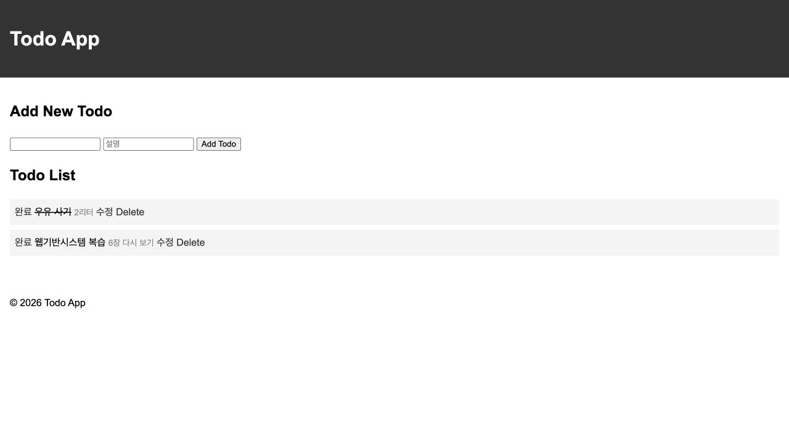
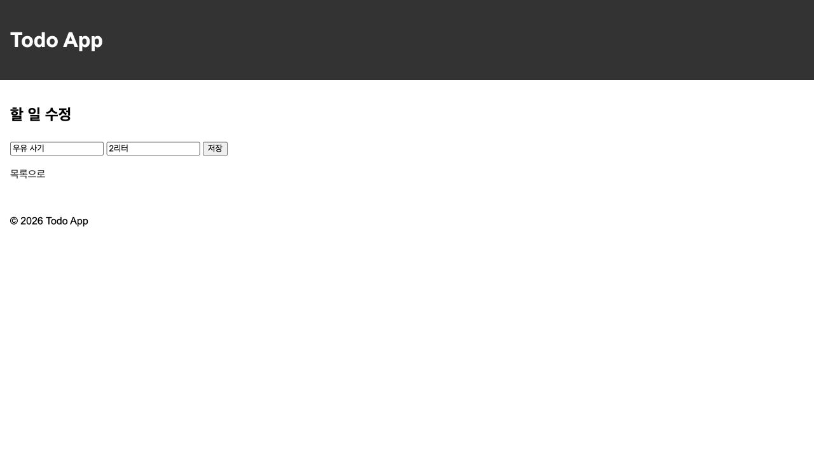
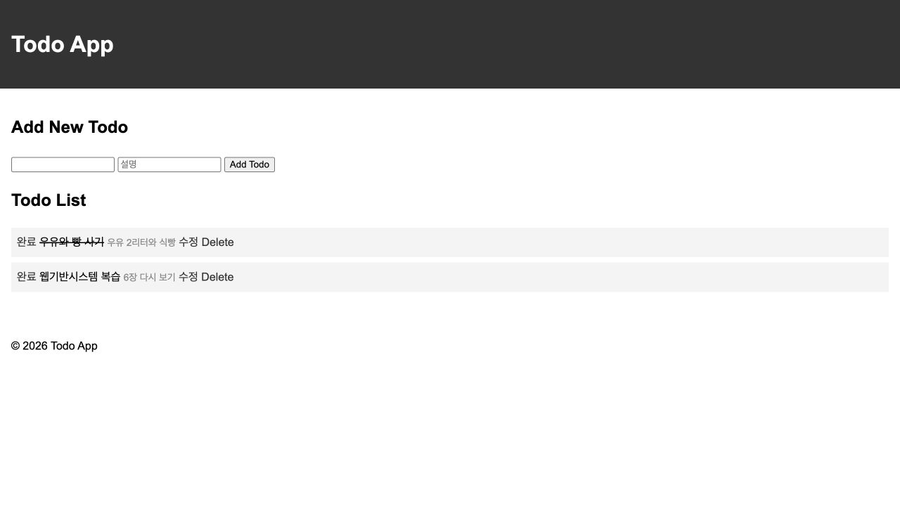

# HW3 Todo 앱 수정 기능

할 일과 설명을 추가·수정하고 완료 상태를 관리하는 Flask 기반 Todo 앱입니다.
SQLite에 저장하므로 서버를 재시작해도 데이터가 유지됩니다.

- 이름: 이종석
- 학번: 21011615

## 라우트

| 메서드 | 경로 | 설명 | 템플릿 |
| --- | --- | --- | --- |
| `GET` | `/` | 할 일 목록과 입력 폼 표시 | `index.html` |
| `POST` | `/` | 할 일과 설명 추가 후 목록으로 이동 | - |
| `GET` | `/edit/<int:id>` | 기존 값이 채워진 수정 화면 표시 | `edit.html` |
| `POST` | `/edit/<int:id>` | 할 일과 설명 수정 후 목록으로 이동 | - |
| `GET` | `/toggle/<int:id>` | 완료·미완료 전환 후 목록으로 이동 | - |
| `GET` | `/delete/<int:id>` | 할 일 삭제 후 목록으로 이동 | - |

## 실행 방법

### 1. 저장소 복제

```bash
git clone https://github.com/Im-Jongseok/flask-practice1.git
cd flask-practice1
```

### 2. 가상환경 생성 및 활성화

```bash
python3 -m venv venv
source venv/bin/activate
```

Windows PowerShell에서는 다음 명령을 사용합니다.

```powershell
venv\Scripts\Activate.ps1
```

### 3. 의존성 설치

`requirements.txt`는 저장소 루트에 있으므로 루트 디렉터리에서 설치합니다.

```bash
pip install -r requirements.txt
```

### 4. HW3 실행

저장소 루트에서 실행합니다.

```bash
flask --app HW3/app --debug run --port 5002
```

실행 후 브라우저에서 `http://127.0.0.1:5002/`에 접속합니다.
`HW3/instance/todos.db`는 처음 실행할 때 자동 생성되며 저장소에는 포함하지 않습니다.
할 일은 공백 제거 후 1~100자, 설명은 선택 입력으로 최대 200자입니다.

## 실행 화면

### 할 일 목록



### 수정 화면



### 서버 재시작 후 목록


