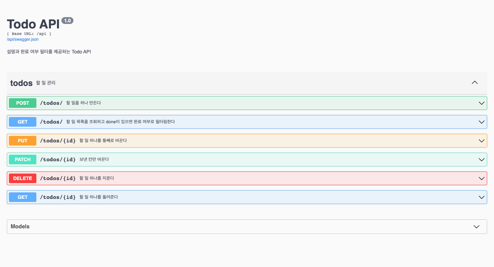
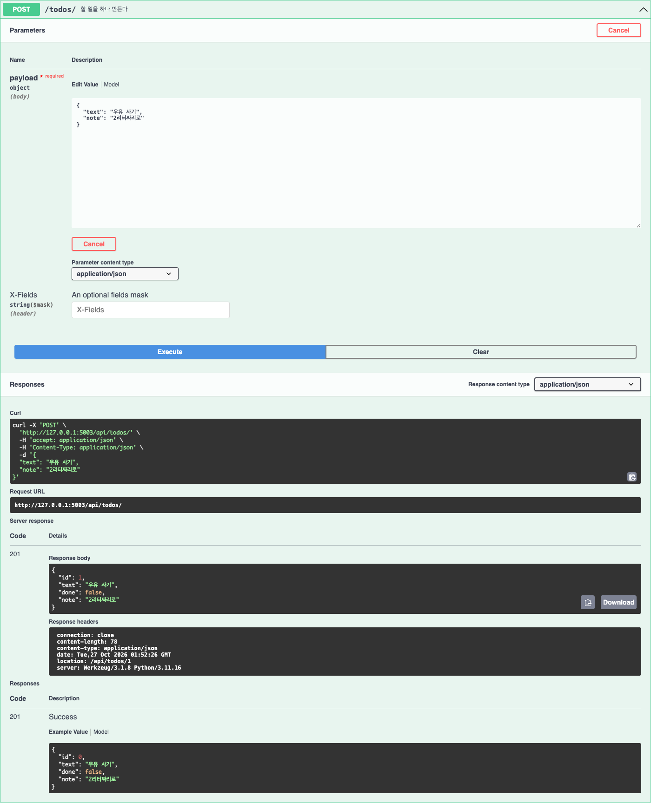
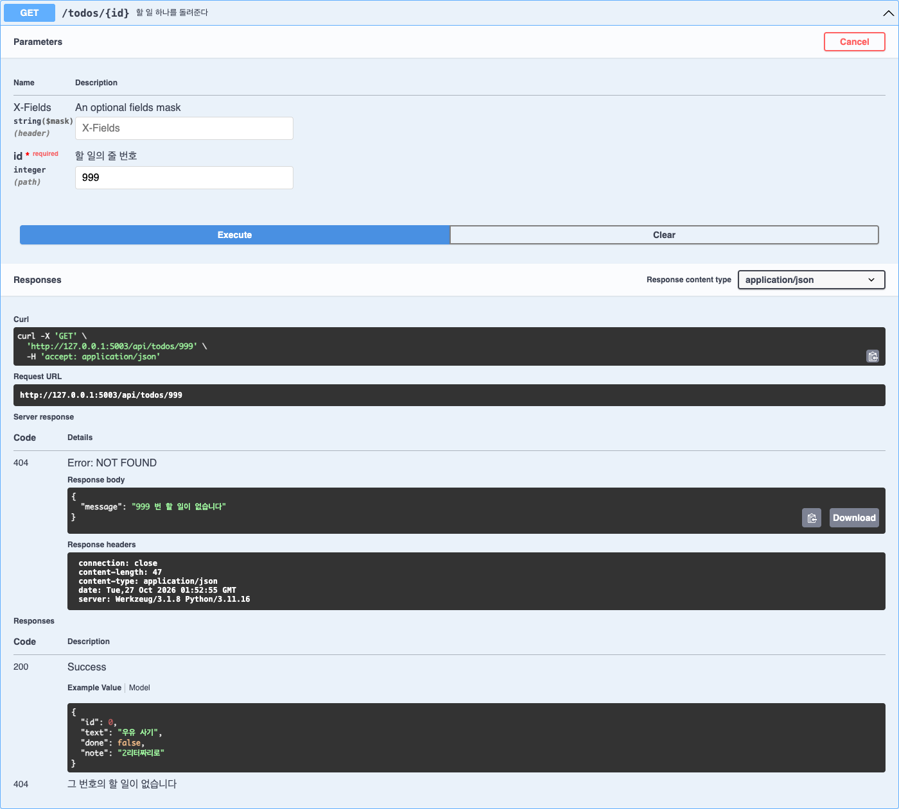

# HW4 Todo API 확장

Flask-RESTX 기반 Todo API에 설명(`note`)과 완료 여부 필터를 추가했습니다.
SQLite에 저장하며 기존 할 일 목록 화면도 함께 사용할 수 있습니다.

- 이름: 이종석
- 학번: 21011615

## 추가한 기능

- POST·GET·PUT·PATCH에서 설명을 주고받습니다. 설명을 생략하고 생성하면 빈 문자열로 저장합니다.
- `?done=true`는 완료, `?done=false`는 미완료 항목을 조회합니다. 조건이 없으면 전체를 반환합니다.
- PATCH는 보낸 필드만 변경합니다. PUT에서 생략한 `done`과 `note`는 각각 `false`, `""`로 바뀝니다.
- 없는 ID는 404와 `{"message": "999 번 할 일이 없습니다"}` 형식의 JSON을 반환합니다.

## API

| 메서드 | 경로 | 설명 |
| --- | --- | --- |
| GET | `/api/todos/` | 전체 목록, 선택적으로 `?done=true` 또는 `?done=false` |
| POST | `/api/todos/` | 생성 후 201과 Location 헤더 반환 |
| GET | `/api/todos/<id>` | 할 일 하나 조회 |
| PUT | `/api/todos/<id>` | 전체 수정 |
| PATCH | `/api/todos/<id>` | 전달한 필드만 수정 |
| DELETE | `/api/todos/<id>` | 삭제 후 본문 없이 204 반환 |

## 실행 방법

저장소 루트에서 가상환경을 준비하고 의존성을 설치합니다.

```bash
python3 -m venv venv
source venv/bin/activate
pip install -r requirements.txt
cd HW4
flask --app app --debug run --port 5003
```

- 화면: http://127.0.0.1:5003/
- API 문서: http://127.0.0.1:5003/api/docs
- API 명세: http://127.0.0.1:5003/api/swagger.json

다른 개발 서버와 구분하려고 5003 포트를 사용합니다. 5000 포트가 비어 있다면 `--port 5003`을 생략해도 됩니다.
`HW4/instance/todos.db`는 처음 실행할 때 자동 생성되며 Git에 포함하지 않습니다.

## 테스트

HW4 폴더에서 실행합니다. 서버를 켜지 않아도 됩니다.

```bash
python -m unittest -v
```

저장소 루트에서는 다음 명령을 사용합니다.

```bash
venv/bin/python -m unittest discover -s HW4 -v
```

테스트 13개로 생성·조회·수정·삭제, note 기본값과 보존, 완료 필터와 전체 조회, 오류 응답, Swagger 명세와 기존 화면을 확인합니다.
앱을 초기화하기 전부터 테스트마다 새 메모리 DB를 사용하므로 실제 SQLite 파일은 변경하지 않습니다.

## 실행 화면

### 전체 API 메서드가 표시된 문서



### 설명을 포함해 생성한 201 응답



### 없는 ID를 조회한 404 응답


